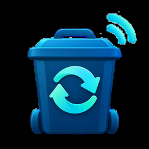

# EcoWaste (WIPE) — intégration Home Assistant

Intégration personnalisée pour les portails de déchets **EcoWaste / WIPE**
(éditeur : OptiWaste SA), utilisés par de nombreuses communes suisses
(`https://wipe.ecowaste.ch/client/<commune>`).

Elle récupère **vos** dépôts de déchets via l'API client officielle et expose
des capteurs dans Home Assistant — sans navigateur headless ni conteneur Docker.

> ⚠️ Projet communautaire non officiel, sans lien avec OptiWaste SA / EcoWaste.
> Vous utilisez **vos propres identifiants** pour accéder à **vos propres
> données**. Respectez les conditions d'utilisation du portail.

## Capteurs créés

Par commune/carte configurée :

| Capteur | Unité | Détail |
|---|---|---|
| Poids total | kg | somme de l'année en cours |
| Coût total | CHF | somme de l'année en cours |
| Nombre de dépôts | dépôts | sur l'année en cours |
| Dernière pesée | kg | + attributs (date, conteneur, carte, flux, coût) |
| Dernier dépôt (date) | horodatage | pour « jours depuis le dernier dépôt » |
| Poids moyen par dépôt | kg | moyenne sur l'année |
| Coût moyen par dépôt | CHF | moyenne sur l'année |
| Prix moyen au kg | CHF/kg | tarif effectif facturé |
| Poids ce mois-ci | kg | mois calendaire en cours |
| Coût ce mois-ci | CHF | mois calendaire (+ attribut « depots ») |
| Poids carte `<label>` | kg | un par carte détectée |
| Coût carte `<label>` | CHF | un par carte détectée |

Rafraîchissement toutes les 6 h (le jeton d'accès, valable ~12 h, est régénéré
automatiquement).

## Installation

### Via HACS (dépôt personnalisé)
1. HACS → menu ⋮ → **Dépôts personnalisés**.
2. URL : `https://github.com/prophetmaster/ecowaste-ha`, catégorie **Intégration**.
3. Installez « EcoWaste (WIPE) », puis **redémarrez** Home Assistant.

### Manuelle
Copiez `custom_components/ecowaste/` dans le dossier `config/custom_components/`
de votre instance, puis redémarrez.

## Configuration

**Paramètres → Appareils et services → Ajouter une intégration → EcoWaste**.

Trois champs :

- **Commune** : le *slug* présent dans l'URL du portail.
  Ex. pour `https://wipe.ecowaste.ch/client/plateau-de-diesse` → `plateau-de-diesse`.
- **Numéro de carte** : tel que vous le saisissez à l'écran de connexion
  (c.-à-d. l'étiquette *sans* la première partie `AAAA-` si elle est présente).
- **Code / nom** : la valeur demandée au 2e écran de connexion.

L'intégration vérifie les identifiants immédiatement en se connectant à l'API.

## Communes / entrées disponibles

La commune se choisit dans une **liste déroulante chargée en direct** depuis le
portail (`/public/api/clients`) — elle est donc toujours à jour. Si le portail
est injoignable, l'intégration retombe sur la liste figée ci-dessous, et la
saisie libre reste possible. Entrées relevées le 23.10.2026 :

<details>
<summary>59 communes suisses</summary>

Aclens, Alt St. Johann, Avenches, Bassins, Blonay, Bofflens, Bretigny, Chamblon,
Davos, Echichens, EMS Le Chateau, Espace Santé Rennaz, Etagnières, Féchy,
Genolier, Grande Béroche, Grande Dixence, Grandson, Granges-Paccot,
Haut de Trembley, Hermenches, L'Abergement, La Brévine, La Côte-aux-Fées,
La Tour-de-Peilz, Lavey, Lavigny, Lavigny (Institution), Le Pâquier,
Les Verrières, Longirod, Lully, Migros Morat, Mont-sur-Rolle, Montagny,
Montaubion-Chardonney, Montreux, Moudon, Nendaz, Nods, Oron, Paudex, Payerne,
Plateau de Diesse, Pont-la-Ville, Préverenges, Rennaz, Romainmôtier, Saillon,
salquenen, Sergey, Sion, Sottens, St-Martin, St-Maurice, Val-de-Travers, Varen,
Vaux sur Morges, Vétroz
</details>

<details>
<summary>16 autres entrées (test / démo / localités françaises)</summary>

Biloba, Bresse et Saone, Cobas, EcoTest, Federer, Mapraz, Minervois, OptiWaste,
Patrimonium, Pepperdine, Retripa, Rouen, Sablé-sur-Sarthe, Strategos, Sud Messin,
Val de Fensch
</details>

> Le slug est déduit du nom (« Plateau de Diesse » → `plateau-de-diesse`). S'il
> ne correspond pas côté serveur, le slug exact est dans l'URL du portail
> `/client/<slug>` — et la liste déroulante accepte la saisie libre.

## Comment ça marche (technique)

```
POST /ipServer/wise/public/wipe/v1/authenticate
     {"client": "<commune>", "card": "<carte>", "code": "<code>"}
  -> {"access_token": "<JWT ~12h>"}

GET  /ipServer/wise/wipe/v1/waste?year=AAAA
     en-tête  X-Client-Token: <JWT>
  -> [ { timestamp, weight, amount, card:{label}, container:{identifier}, flowType:{name} }, ... ]
```

## Limitations connues

- Les cartes sont découvertes au démarrage ; si une **nouvelle carte** apparaît,
  rechargez l'intégration pour créer ses capteurs.
- Seule l'**année en cours** est remontée (comme le portail). L'historique
  complet reste accessible année par année via l'API.
- API non documentée publiquement : un changement côté OptiWaste peut nécessiter
  une mise à jour.

## Licence
MIT — faites-en bon usage.
